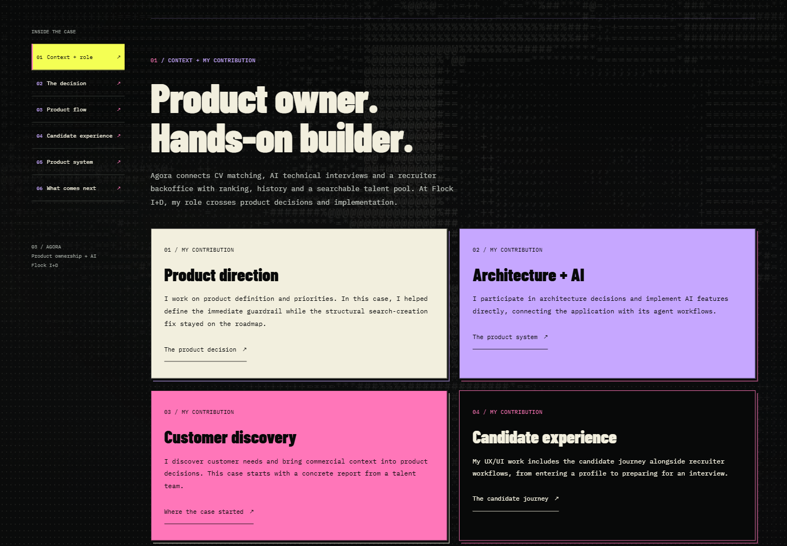
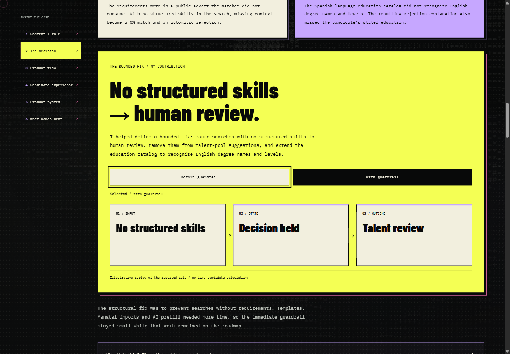
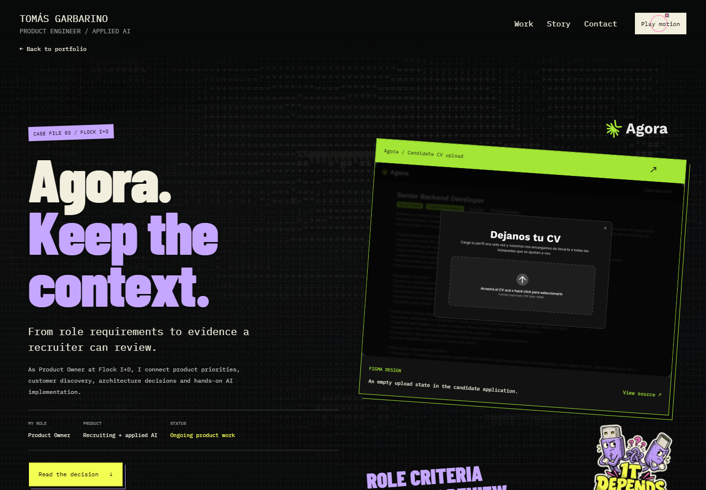

# Agora case and career story

## Summary

Agora has a dedicated case at `/en/agora`. Its short home preview leads into personal contribution, a real matching decision, product flow, published JEV research, candidate interfaces and the declared stack. The career story names five steps instead of compressing company experience into the third art chapter.

## User experience

The author confirmed this sequence: Minecraft experiments → offering digital menus → frontend at Hogarth Worldwide → frontend engineering and leadership at Batech → AI product engineering at Flock I+D. Agora and Trainly are projects within the Flock stage. No dates, clients or results were inferred from that sequence.

The career story now uses five complete scenes that advance with the reading position, replacing the earlier three-chapter summary plus separate chronology. Its chromatic lens and keyboard controls remain available. The two Flock project cards stay inside that stage, link to their respective cases and can be moved from their surfaces.

The Agora dossier has a section rail and direct links to the incident decision. A search without structured skills had produced an automatic rejection; the case explains the separate education-catalog gap, alternatives considered, bounded human-review guardrail and team-reported replay/control check. Personal contribution stays distinct from reported team validation. The case does not claim overall model accuracy or business impact.

Candidate artifacts now show the actual application rendered locally with fictional data. Candidate entry and interview-ready screens replace the earlier design references; a criterion-level evidence excerpt accompanies the research contribution. The portfolio retains no image foot captions or source-link footers. Demo provenance appears in meaningful narrative and descriptive alt text. Drag, notes, native disclosures, related-case links and the shared header use the portfolio's shared interaction components. Global pause and reduced motion extend to the page and its silent ASCII environment. Earlier source-link and caption checks below describe the preceding layout.

## Technical overview

- `src/app/en/agora/page.tsx`: route metadata, canonical URL and Open Graph interface image.
- `AgoraDossier.tsx` / `agora-dossier.css`: dedicated narrative, event-driven section rail, candidate frames and scoped visual system.
- `AgoraDecisionReplay.tsx` / `agora-decision-replay.css`: fixed before/after rule states with independent hover, focus and pinned selection; no live evaluation.
- `AgoraResearch.tsx` / `agora-research.css`: always-visible retrospective comparison, contribution, CV review-load trade-off, method and full-paper link. Shared scroll wrappers and whole-surface drag; no custom animation loop.
- `AgoraProductLayers.tsx` / `agora-product-layers.css`: scroll-opened product window linking experience, AI workflows and the human-review guardrail to always-visible personal contributions. The application/agent hosting stack remains visible alongside those responsibilities.
- `AgoraCase.tsx`: concise home preview with the existing `AgoraFlow` and full-case links.
- `OriginStory.tsx` / `origin-story.css`: explicit career sequence and the two Flock projects.
- `SiteHeader.tsx`: configurable native return target; Agora returns to `/#agora`, Trainly retains `/#trainly`.
- `ProductWork`, `TrainlyDossier`, sitemap and `/agora` alias: connected case navigation and discovery.

There are no new dependencies, APIs, database operations or environment variables. The section observer and motion components clean up listeners and observers. Mobile Flock project cards keep their reading width while an outer gutter reserves horizontal drag space. The Agora hero retains its rotated frame and sticker. Dragged nodes keep the existing geometric connector logic; chapter artwork remains mounted.

## Complete recruiter review capture — 2026-10-13

The research contribution now shows the complete requirement/evidence/review interface instead of its narrow Excel excerpt. A recruiter can see the requirement judgments, supporting CV text, review reason and the two next-action choices in the same image. The adjacent narrative identifies the author's design and implementation of this interface; the team retains credit for the base platform. This is a fictional local demo, not the trainee incident's candidate or a hiring outcome. It does not establish whether the corresponding production migrations have run.

The new source is the publication-approved `export/agora/screens/agora-03-evidencia-por-requisito.png`, copied unchanged to `public/media/agora/`. The original-image link opens this full 1440×900 capture. Whole-surface drag still starts on the image; the link remains a native control. The existing contribution note, scroll wrapper, research results, candidate screens and layered system keep their behavior. Home cursor previews and Agora Open Graph now use the same review interface. The preceding small excerpt remains available as a historical asset, without a second repeated image in the reading flow.

Full ESLint, TypeScript and optimized Next.js build `L9COYo1uqihApO_xxthcC` passed for this integration. All 12 route/metadata checks and seven local image/content checks passed; the five new image responses match their approved source hashes. Native browser verification covered the full review image and attribution, whole-image dragging, keyboard reset, opening the 1440×900 original, 320px bounds and the existing layered system clearing its selection on reverse scroll. Shared interaction controls were preserved. The PR records preview verification separately. No new dependencies, APIs, DB operations or environment variables are required.

## Published JEV research — 2026-10-13

Reading order: **role → incident decision → product flow → published research → candidate experience → system → next**. The new `#research` rail entry identifies a separate retrospective study rather than implying that the earlier guardrail produced the benchmark result. Existing candidate anchors remain compatible.

The comparison shows 80.9% agreement for JEV and 54.1% for the historical interview evaluator, a 26.8 percentage-point difference. Its denominator is the 220 questions with a majority-panel label from 48 interviews. Corpus counts remain distinct: 496 applications and 221 extracted questions. Confidence intervals remain visible. A CV-policy example shows exact retrospective review counts of 32 and 136 when the rejection threshold changes from 0.30 to 0.05; the UI does not present that alternative as deployed.

Personal contribution attributes the paper to its author and implementation of structured requirements, evidence per criterion, JEV integrations and review controls to Tomás, with AI coding agents. The team receives credit for the base platform. Visible limitations include one client's CV search, 60 human-labeled CVs, one product-team annotator, sensitivity to labeling, and no measured hiring quality or fairness. Further methodology is available through a native disclosure. The primary link opens the [full public research](https://www.flocklabs.ar/research/como-decide-jev-en-agora-probabilidades-umbrales-y-revision-humana).

The chart uses explicit labels and a common 0–100% bar scale. Hover adds emphasis without changing numbers or requiring discovery to read them. Its window and implementation note use existing `ArtifactDrag`; outer wrappers use `ScrollMotion` so drag and parallax do not compete for `translate`. Shared Pause motion/reduced motion disable CSS transitions and decorative scroll motion while controls remain usable. The informative criterion image uses Next Image with an intrinsic ratio and lazy loading, plus a keyboard-accessible original-image link for narrow screens. Methodology distinguishes the threshold explored on the same sample from cost-based cross-validation and records the absence of a reserved holdout.

Three publication-approved images came from the 2026-10-13 Agora/Trainly export prepared on the work computer: candidate entry, interview ready and uncertain-criterion evidence. They show actual interfaces with fictional fixtures; they do not establish a live backend call, a real voice interview or production adoption. No private references, raw candidate records, company source code or work-machine tools are included in this repository. Trainly assets and simulated-voice clips remain outside this change.

Full ESLint, TypeScript and the optimized Next.js 16.3.8 build passed with the bundled Node.js 24.19.0 runtime. Build `5-W3L_wzWqexe90TJqElR` serves the three static portfolio routes; all 12 route/metadata checks passed. The three PNGs return HTTP 200 and match the approved export bytes. Native browser checks cover always-visible results, source navigation, original-image keyboard access, methodology disclosure, whole-surface drag with simultaneous scroll, keyboard movement/reset, stable hover layout, shared Pause/reduced motion, 320/390px geometry and existing product-layer selection clearing on reverse scroll. An initial offscreen-image check is recorded as a lazy-loading diagnostic and its corrected visible-section check passed. These portfolio checks do not validate Agora's backend or AI outcomes; physical touch hardware and FPS profiling were not tested.

Local evidence: `output/agora-jev-research-2026-10-13/` in the development workspace. The earlier standalone Playwright script below is historical and was not used for this addition. Rollback is a revert of this scoped addition. No data, API or environment rollback is required.

## Layered product window — 2026-10-13

The product-system section now presents one paper window in perspective. Native forward/reverse scroll gradually separates its experience, AI and decision planes. Hover, keyboard focus and click/tap highlight the associated contribution and gently lift that plane; the explanations never depend on opening a hidden panel. The window and explanation surfaces share `ArtifactDrag`, including arrow movement and Home reset.

Animation uses bounded CSS variables and a settling RAF that stops when converged, offscreen, hidden or held. Pointer presses freeze decorative movement before drag intent; movement keys on drag grips do the same. Real scrolling clears manual previews and requires fresh mouse movement before hover can resume, so a stationary cursor cannot pin the narrative. The controller does not prevent wheel/touch events, move focus or reset drag offsets. Shared Pause motion and reduced motion show static expanded layers; resuming starts from the current values. Explicit click pins remain separate from temporary hover/focus.

Native browser validation covers desktop hover/depth and contribution emphasis, Tab/Escape, whole-surface drag with simultaneous scroll, keyboard movement/reset, forward/reverse scroll after selection, shared pause and emulated reduced motion, and 390/320px layouts. No horizontal overflow or captured console errors was observed. Mobile checks use viewport emulation and mouse click equivalents; physical phone touch hardware was not tested. Local evidence is in `output/layered-interactions-2026-10-13/browser-checks.json`.

Full ESLint, TypeScript and the optimized Next.js build passed with Node.js 24.19.0. Build `1kvcC9U2Fo4ZpMWaEuCas` prerenders home, Agora and Trainly; all 12 route/metadata checks passed. An optimized-build hover check retained the next section's document position. These gates verify the portfolio implementation; they do not evaluate Agora's live AI or hiring outcomes.

Rollback is a revert of the scoped interaction commit. The existing motion control immediately disables decorative animation without disabling controls or drag. No product backend, live candidate data, external runtime service or new dependency is involved.

## End-to-end refinement — 2026-10-11

The reading order is now **role → decision → flow → candidate experience → system → next**. The hero names the Product Owner role at Flock I+D and its five areas of responsibility. Four contribution cards link those responsibilities to supporting parts of the case, replacing a generic product setup that delayed the author's involvement.

The incident starts with the talent team's report of a student rejected for a trainee search. Two separate causes follow: the search had no structured skills, and the education catalog missed English aliases. The author's contribution remains “I helped define a bounded fix”; release checks are explicitly team-reported. The case explains why an immediate guardrail and the longer search-creation work had different scopes. Its concrete result heading is “One decision changed. Scores stayed the same.”

The yellow decision frame includes a replay of the reported rule. Hover or keyboard focus previews a state, click or Enter pins it, and Escape restores “With guardrail”. Hover and focus are independent, so clearing one does not discard the other. Both states retain the same footprint. The replay is labeled illustrative and does not run a candidate calculation.

The page shares the home and Trainly ASCII world, pink cursor, paper surfaces, peel stickers, surface dragging and scroll depth. Its world now consumes the shared scroll field, including reduced motion. Two additional stickers connect candidate experience and bounded validation to the visual language. Local mobile gutters provide actual horizontal travel inside drag boundaries. An opened hero sticker's note now sits beside the sticker, leaving its Figma source link reachable. The section rail resets correctly when returning to the hero.

### Current validation

- Node.js 24.19.0: lint, TypeScript and production build passed in the curated PR checkout. Final build: `WMpEIhMlsktMLcCo2mytn`; all three pages prerender successfully.
- **20 accepted checks passed in the Codex in-app browser** against the main workspace development server at 1440, 390 and 320 px. This browser's version was not exposed. Coverage includes contribution surface drag/reset, five mobile frame families' keyboard travel/reset, all six section anchors, reading-band tracking, open/closed sticker source hit targets, replay preview/pin/Escape and stable height, flow connector movement, keyboard details and cross-page navigation with persisted pause.
- Silent autoplay was observed with time advancing, muted audio, looping enabled and controls hidden. The shared scroll field moved the Agora world; global pause froze video and field. Emulated reduced motion stopped decorative movement while replay controls remained usable.
- **12 HTTP checks passed against that production build**: six redirects, metadata for all three pages, robots, the three-entry sitemap and a 404. Browser interaction checks used the development server; they are not attributed to the production build ID.
- `verify-agora-story.py` was extended for the new reading order, contribution links, replay behavior, open-note source clearance and mobile movement. Python syntax was checked. Its Playwright suite was **not executed in this audit**; the actual interaction checks used the selected in-app browser.

Current local evidence: `output/agora-review-2026-10-11/AUDIT.md`, `browser-checks.json` and `routes-production.json`. Diagnostic input/capture attempts remain recorded separately from accepted checks. No dependencies, APIs, database operations or environment variables were added.

## Initial dossier milestone validation — historical

Validated with Node.js 24.19.0 and an existing Chromium 149.0.7827.55, using the curated PR checkout.

- Lint, TypeScript and the production build passed. The final build is `o5LjCKYCVrlICAP9zvgQe`; `/`, `/en/agora` and `/en/trainly` prerender successfully.
- Eighteen native browser checks passed at 1440, 390 and 320 px on build `7tIPuyU15ohNo1Rg2Gv18`: chronology, chapter geometry, dossier reading, flow dragging/connectors, notes, native selection/copying and navigation between all three pages with persisted pause and reduced motion.
- Six targeted checks passed on the final build after correcting the hero sticker clearance and the mobile career-card movement boundary. They include surface drag and keyboard restore, all six case anchors, native wheel section tracking, disclosures, loaded Figma images and an unobstructed source-link hit target.
- Twelve HTTP checks passed on the final build: six redirects, three pages with canonical/description/language/one H1, robots, the three-entry sitemap and a 404.
- Story stage height stayed identical across all three chapters: 760 / 1050.6875 / 1069.46875 px at those respective widths. The document position of selected work stayed unchanged.

Those milestone reports are `output/portfolio-design-2027/agora-story-native-v2.json`, `agora-story-final-v2.json` and `agora-story-routes-final.json`. They were not rerun in the 2026-10-11 audit. The earlier relative-output harness failure and the two reproduced UI issues remain in local evidence; corrected checks passed at that milestone. Those browser journeys observed no horizontal overflow, JavaScript errors or failed resources.

The scripts are `scripts/verify-agora-story.py` and `scripts/verify-portfolio-routes.py`; they require an already-running local preview and an existing Chromium for browser checks. Supply the serving checkout with `--app-root` and its `.next/BUILD_ID` with `--build-id`.

## Risks and follow-ups

Real phone touch dragging, text-selection callouts and OS handles were not certified by the current in-app audit. Mobile geometry and keyboard travel were verified; the in-app CDP endpoint did not support touch dispatch. Figma frames show design states rather than live candidate records. Reported production checks are a bounded incident account, not an independent model benchmark. No FPS, other-browser or hiring-conversion result is claimed. The PR preview is separate from production rollout.
