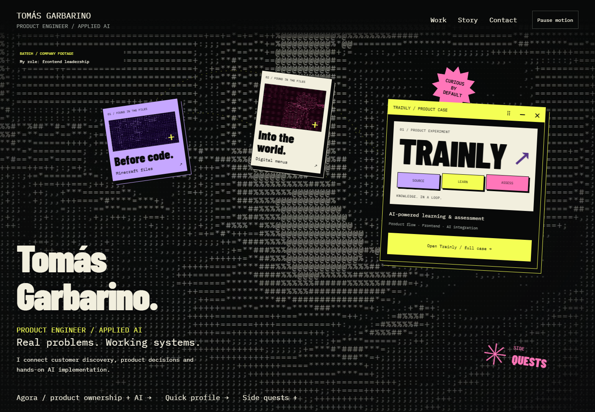
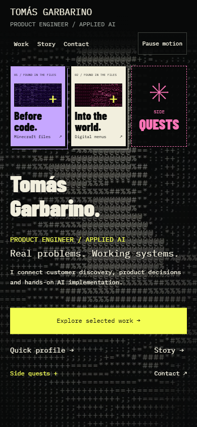

# Observatory portfolio

## Summary

The portfolio connects a distinctive visual entrance to evidence of product judgment and implementation. Visitors can take a quick route through the case index and profile or explore the story, movable artifacts and product details. The application replaces the previous React/CRA frontend with Next.js App Router.

## User experience

The home follows entrance → origin story → case index → Trainly summary → Batech → Agora → contact. The case index provides direct paths to all three cases without requiring the full sequence. The Trainly dossier preserves the longer product narrative.

Three Story panels share a natural CSS grid footprint, so selecting a chapter does not move the sections below. Artwork stays mounted and only the selected chapter is interactive. Discovery objects maintain separate hover, focus, panel focus and pin state. Keyboard focus inside a detail remains available when the pointer explores another object.

Whole-surface drag yields to controls, native text selection, touch scrolling and long presses. The keyboard grip supports arrows, Shift for larger steps, Home to restore and Escape to cancel movement. Text can be selected with native double-click then drag or Alt-drag; selections persist after releasing Alt. Mobile OS selection handles still require real-device verification.

Agora's illustrative flow measures node rectangles and reconnects edges after drag, keyboard movement, reset and resize. Overlapping or obstructed edges are hidden rather than pointing at the wrong node. Evidence and Review notes support hover, keyboard focus and tap pinning, in a shared reserved area that avoids layout shifts.

## Technical overview

`src/app/page.tsx` composes the home. `Observatory`, `OriginStory`, `ProductWork` and `AgoraCase` hold the narrative; `TrainlyDossier` supplies `/en/trainly`. Product content stays in source files; the site does not call live candidate systems, databases or AI services.

`ArtifactDrag` applies CSS translation and emits bubbling `tg-artifact-move` with `{ x, y }` after applying offsets. `AgoraFlow` coalesces these events with resize/font observations into one measurement frame. It does not run an idle animation loop. Scroll movement of the whole flow shares coordinates with its SVG.

`MotionPreference` provides one persisted play/pause state. `AsciiVideo`, `BatechVideo`, `AmbientMotion` and `ScrollMotion` retain reduced-motion, visibility and offscreen safeguards. The chromatic Story lens remains confined to its frame and video interior. Pause is independent of dragging and navigation.

`QuickProfileButton` uses the same dialog entry event as the hero. `PortfolioDialogs` dispatches the selected Story chapter before following its anchor. `TrainlySectionNav` observes a reading band and native hash navigation without controlling scroll.

## Operational notes

Install with Node.js 24.x and `npm ci`. The `engines.node` entry in `package.json` overrides the previous Vercel project's discontinued Node 18 setting. Production uses `npm run build` and `npm start`; `vercel.json` selects the Next.js framework and `.next` output. No environment variables or external credentials are required. Static assets and font licenses live under `public/`.

Legacy entries redirect permanently: `/en` and `/es` to `/`; `/trainly`, `/es/trainly` and `/trainyl` to `/en/trainly`. Canonical metadata and the two-entry sitemap retain the existing public domain. There is currently one English edition, so Spanish language alternates are not advertised. Previous CRA SEO/prerender documentation remains historical in the docs index.

## Validation

Validated on production build `APml2lnGUPQzOpeJnJlJT`, using the curated PR checkout, with Node.js 24.19.0 and Chromium 149.0.7827.55. All 41 active source files matched the local implementation by SHA-256.

- `npm ci`, `npm run lint`, `npm run typecheck`, `npm run build`: passed.
- `python scripts/verify-arena-refinement.py`: 26 logical checks passed in fresh browser contexts at 1440, 390 and 320 px. Covered chapter geometry, mixed focus, native double-click/Alt selection and Ctrl+C, surface drag, keyboard restore, connector endpoints/overlap/resize, touch scrolling, notes, profile/quest navigation, silent autoplay, pause and reduced motion. A short actual-speed scroll recording is qualitative evidence only.
- Story stage height was identical across its three chapters: 760 / 1076.9375 / 1148.21875 px at those respective widths. Work's document position stayed unchanged.
- Independent Trainly journey passed at all three widths: rail/hash/native scroll, five artifact links, target outlines, disclosures, keyboard controls and motion preferences. Its five stage heights remained 564.375 / 630.53125 / 712.3125 px, with zero change between selections. No horizontal overflow, page errors or resource failures were observed.
- `python scripts/verify-portfolio-routes.py`: 10 checks passed for redirects, rendered metadata, sitemap/robots and an unknown route.

The browser script requires an already-running local server. Use `--app-root` and `--build-id` when exercising a checkout other than the script's own project. Earlier harness failures were retained in the local evidence: SVG paths with zero height, deliberate node overlap during a non-overlap assertion, fixed-delay motion waits, history shortcut behavior and uppercase rendered labels. They were corrected and rerun; source remained unchanged during QA.

Native mobile touch drag preserves vertical scrolling and leaves the keyboard grip reachable by Tab. Emulated long press kept the card still but produced no text range; real phone selection callouts and handles remain unverified. No FPS, other-browser or hiring-conversion result is claimed.

Representative captures:

## Risks and follow-ups

- Real mobile long-press selection handles cannot be certified through Chromium touch emulation alone.
- Agora's reported production check is a bounded incident validation, not a model benchmark. Trainly quantitative outcomes and a direct Batech frontend artifact remain unavailable; the copy makes no substitute claims.
- A PR preview verifies implementation, not hiring conversion. Production rollout remains separate from this change.
